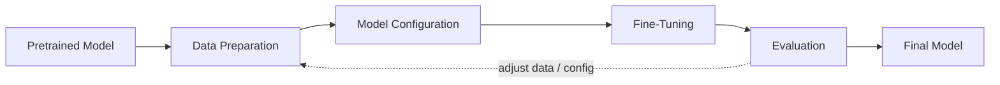
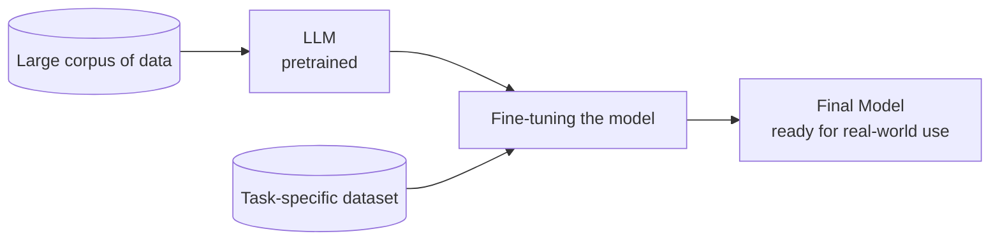
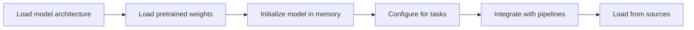
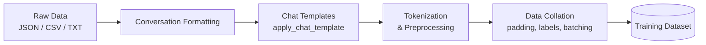
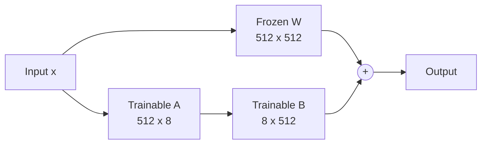
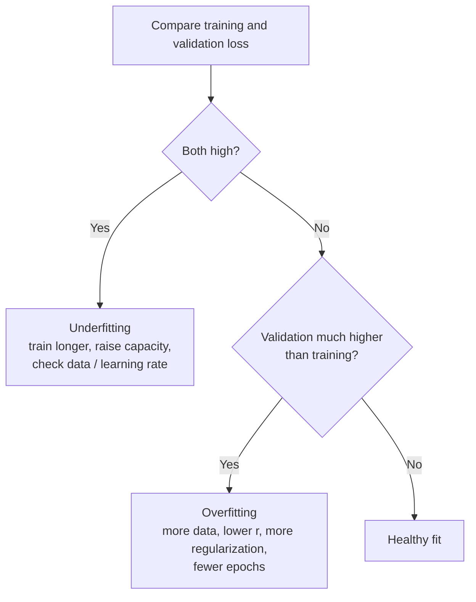
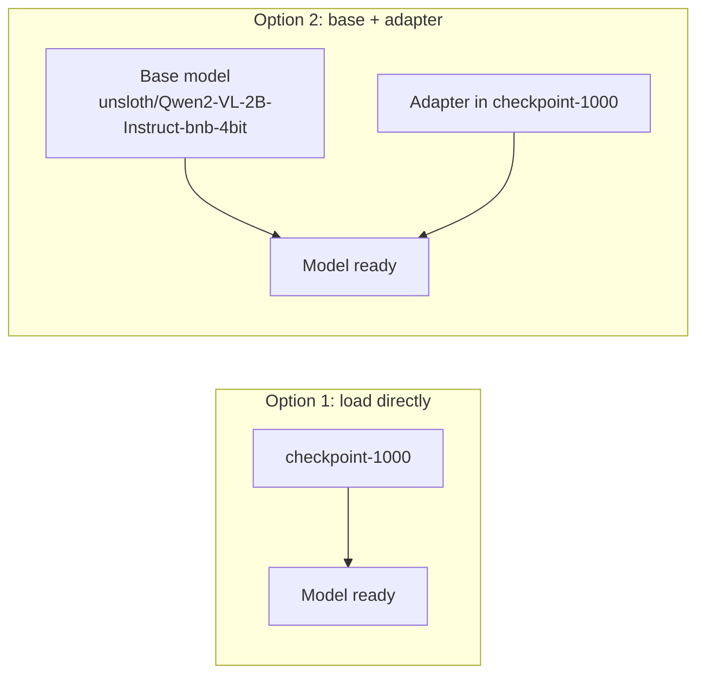

# LLM Model Fine-Tuning

> Study notes on **LLM Model Fine-Tuning**, based on the lecture by **Vann Visal**, using Hugging Face Transformers, PEFT/LoRA and TRL's `SFTTrainer`.


---

## About this repository

This repository documents my learning of Large Language Model (LLM) fine-tuning. It is a **study note**, not a research report.

- **Source:** the lecture slides *"LLM Model Fine-Tuning"* by Vann Visal. The structure, terminology and the core code snippets come from these slides.
- **No experiment results are claimed.** I did not run or report any fine-tuning experiment in this repository. Any numbers shown are either arithmetic (for example the LoRA parameter count) or output printed on the lecture slides, and they are labelled as such.
- **How to tell lecture content from my additions.** Blocks marked with 📎 *Additional note* are extra explanations or example code that I added to make the topic easier to understand. They are **not** from the lecture. Code marked "from the lecture" follows the slides, with small fixes to formatting and typos.

> **Note on the lecture's running example.** The slides use a vision-language model (`Qwen/Qwen2-VL-2B-Instruct`) fine-tuned with Unsloth for object detection and robot-arm commands. I keep that example where the lecture uses it, and add plain text-only examples where they are easier to follow.

---

## Table of Contents

- [Project Overview](#project-overview)
  - [What is LLM fine-tuning?](#what-is-llm-fine-tuning)
  - [Why is fine-tuning important?](#why-is-fine-tuning-important)
  - [Learning objectives](#learning-objectives)
  - [End-to-end workflow](#end-to-end-workflow)
- [1. Fine-Tuning](#1-fine-tuning)
- [2. Model & Preprocessor Setup](#2-model--preprocessor-setup)
  - [2.1 Model selection](#21-model-selection)
  - [2.2 Model loader](#22-model-loader)
  - [2.3 Processor loader](#23-processor-loader)
  - [2.4 Quantization](#24-quantization)
  - [2.5 Model setup](#25-model-setup)
- [3. Data Preparation](#3-data-preparation)
  - [3.1 Raw data formats](#31-raw-data-formats)
  - [3.2 Conversation formats](#32-conversation-formats)
  - [3.3 Chat templates](#33-chat-templates)
  - [3.4 Tokenization and preprocessing](#34-tokenization-and-preprocessing)
  - [3.5 Data collators](#35-data-collators)
- [4. Supervised Trainer Setup](#4-supervised-trainer-setup)
  - [4.1 PEFT](#41-peft-parameter-efficient-fine-tuning)
  - [4.2 LoRA](#42-lora-low-rank-adaptation)
  - [4.3 LoRA configuration](#43-lora-configuration)
  - [4.4 SFTConfig](#44-sftconfig)
  - [4.5 SFTTrainer and training](#45-sfttrainer-and-trainertrain)
- [5. Training Diagnosis](#5-training-diagnosis)
  - [5.1 Training loss and validation loss](#51-training-loss-and-validation-loss)
  - [5.2 Overfitting and underfitting](#52-overfitting-and-underfitting)
  - [5.3 Weights & Biases](#53-weights--biases-wandb)
- [6. Model Checkpoints](#6-model-checkpoints)
- [Glossary](#glossary)
- [References](#references)

---

## Project Overview

### What is LLM fine-tuning?

**Fine-tuning** is a technique where a **pretrained model** is adapted to a new, specific task by continuing its training on a smaller, task-specific dataset. It reuses the knowledge the model learned from large-scale datasets and adjusts the model's parameters to improve performance on the new task.

### Why is fine-tuning important?

| Reason | Explanation |
|---|---|
| **Reuses existing knowledge** | The model already learned language (or vision) patterns from a very large corpus, so we do not start from zero. |
| **Needs less data** | Only a smaller, task-specific dataset is required. |
| **Task-specific performance** | The model's parameters are adjusted so it performs better on the target task. |
| **Ready for real use** | The result is a final model that can be used in real-world applications. |

📎 *Additional note:* Training a large model from scratch needs huge datasets and compute. Fine-tuning, especially with PEFT methods such as LoRA (Section 4), makes adaptation possible on much smaller hardware.

### Learning objectives

By working through this project I want to be able to:

1. Explain what fine-tuning is and describe its workflow.
2. Choose a suitable pretrained model and load it, with its processor, using Hugging Face Transformers.
3. Reduce memory use with quantization (`BitsAndBytesConfig`).
4. Prepare data: raw format → conversation format → chat template → tokenization → data collator.
5. Explain PEFT and LoRA, including the formula `W' = W + AB` and the parameter savings.
6. Configure `SFTConfig` and `SFTTrainer` and start training with `trainer.train()`.
7. Read training and validation loss and recognize overfitting and underfitting, with Weights & Biases.
8. Use model checkpoints to resume, evaluate and load models.

### End-to-end workflow



*Figure 1. Overall fine-tuning workflow. The dotted arrow is my addition: if evaluation is poor, we usually go back and adjust the data or configuration.*

---

## 1. Fine-Tuning

### Definition

> **Fine-tuning** is a technique where a pretrained model is adapted to a new, specific task by continuing its training on a smaller, task-specific dataset. It leverages the knowledge learned from large-scale datasets and adjusts the model's parameters to improve performance on the new task. *(Lecture)*

### How a pretrained model is adapted

The lecture shows three stages:

1. **LLM** – a model pretrained on a **large corpus of data**.
2. **Fine-tuning the model** – training continues on a **task-specific dataset**.
3. **Final model** – ready to be used in real-world applications.



*Figure 2. Fine-tuning a pretrained LLM (redrawn from the lecture diagram).*

### Fine-tuning workflow in this project

The lecture's six topics follow the practical order of a fine-tuning project:

| Step | Topic | What happens |
|:---:|---|---|
| 1 | **Fine-Tuning** | Understand the idea and the overall workflow. |
| 2 | **Model & Preprocessor Setup** | Choose and load the model, processor and quantization settings. |
| 3 | **Data Preparation** | Convert raw data into model-ready training data. |
| 4 | **Supervised Trainer Setup** | Configure PEFT/LoRA, `SFTConfig` and `SFTTrainer`, then train. |
| 5 | **Training Diagnosis** | Watch the loss curves and track experiments. |
| 6 | **Model Checkpoints** | Save, resume, compare and load training states. |

---

## 2. Model & Preprocessor Setup

### 2.1 Model selection

The lecture lists **five factors** to consider when choosing a model to fine-tune:

| # | Factor | Meaning (lecture) | 📎 Beginner-friendly note |
|:---:|---|---|---|
| 1 | **Task Alignment** | Choose models based on task type and pretraining. | Pick a model whose pretraining already resembles your task (text generation, classification, vision + text, ...). |
| 2 | **Model Architecture** | Evaluate architecture suitability and modularity. | Decoder-only (GPT-style), encoder-only (BERT-style) and encoder-decoder (T5-style) models suit different tasks. |
| 3 | **Model Size and Complexity** | Balance model size with available resources. | Bigger models are usually more capable but need more GPU memory and time. |
| 4 | **Performance Benchmarking** | Assess existing performance and transfer learning. | Check published benchmarks to see how well the model already does on similar tasks. |
| 5 | **Community Support and Documentation** | Ensure documentation and framework support. | A well-documented model with an active community is easier to debug and reuse. |

### 2.2 Model loader

A **model loader** is a utility or function that loads a pretrained model, its **architecture** and its **weights (parameters)** into memory so it can be used for **inference** or **further training (fine-tuning)**.



*Figure 3. What a model loader does (from the lecture's six steps).*

In Hugging Face **Transformers** there are two main categories of loaders.

#### Model-specific loaders

Tied to **one specific architecture**. Use them when you know the exact model type (for example BERT, GPT-2 or T5).

```python
from transformers import (
    BertForSequenceClassification,
    GPT2LMHeadModel,
    T5ForConditionalGeneration,
)

# Each class only works with its own architecture (examples from the lecture)
bert = BertForSequenceClassification.from_pretrained("bert-base-uncased")
gpt2 = GPT2LMHeadModel.from_pretrained("gpt2")
t5   = T5ForConditionalGeneration.from_pretrained("t5-small")
```

#### AutoModel loaders

The `AutoModel` classes **automatically select the correct architecture** from the model identifier you give. This hides the architecture details and makes it easy to switch between models.

```python
from transformers import (
    AutoModelForSequenceClassification,
    AutoModelForTokenClassification,
    AutoModelForCausalLM,
)

# Examples from the lecture
clf  = AutoModelForSequenceClassification.from_pretrained("bert-base-uncased")
tok  = AutoModelForTokenClassification.from_pretrained("roberta-base")
lm   = AutoModelForCausalLM.from_pretrained("gpt2")
```

**Summary of AutoModel variants (from the lecture):**

| AutoModel loader | Description |
|---|---|
| `AutoModel` | General-purpose model, no specific task or head attached. |
| `AutoModelForSequenceClassification` | Sequence classification tasks (e.g. text classification). |
| `AutoModelForTokenClassification` | Token classification tasks (e.g. NER). |
| `AutoModelForQuestionAnswering` | Question answering tasks. |
| `AutoModelForCausalLM` | Autoregressive text generation (e.g. GPT). |
| `AutoModelForMaskedLM` | Masked language modeling (e.g. BERT). |
| `AutoModelForSeq2SeqLM` | Sequence-to-sequence tasks (e.g. T5, BART for translation or summarization). |
| `AutoModelForSpeechSeq2Seq` | Speech-to-text models (e.g. ASR). |
| `AutoModelForVision` | Visual tasks such as image classification. |
| `AutoModelForImageSegmentation` | Image segmentation tasks. |

📎 *Additional note:* In current Transformers releases the image-classification loader is named `AutoModelForImageClassification`. The name `AutoModelForVision` is the one used on the lecture slide.

### 2.3 Processor loader

Like `AutoModel`, the **`AutoProcessor`** class automatically selects the right processor for the model you use. Different processors handle different kinds of input, and they combine the functions of **tokenizers, feature extractors and image processors**.

**Processor types in the lecture:** Tokenizer, Image Processor, Audio Processor, Multimodal Processor and Audio-Text Processor.

```python
from transformers import AutoProcessor, Qwen2VLProcessor

model_name = "Qwen/Qwen2-VL-2B-Instruct"

# Option 1: model-specific processor
processor = Qwen2VLProcessor.from_pretrained(model_name, use_fast=True)

# Option 2: let AutoProcessor choose the right class
processor = AutoProcessor.from_pretrained(model_name, use_fast=True)
```

| Processor type | Handles | 📎 Example input |
|---|---|---|
| Tokenizer | Text → token IDs | A sentence |
| Image Processor | Image → pixel tensors | A photo |
| Audio Processor | Audio → feature tensors | A recording |
| Multimodal Processor | Several input types together | Image + text prompt |
| Audio-Text Processor | Audio and text together | Speech + transcript |

📎 *Additional note (text-only models):* for a plain text model, `AutoTokenizer.from_pretrained("gpt2")` is the usual equivalent.

### 2.4 Quantization

**Quantization** reduces the numerical precision of a network's weights or activations. The goal is to make models **smaller, faster and more efficient**. Weights are often stored as 32-bit floating-point numbers (**FP32**); quantization uses lower-bit formats such as **FP16** (16-bit floating point) or **INT8** (8-bit integers).

| Format | Bits | Bytes per weight | 📎 Rough memory for 1 billion parameters* |
|---|:---:|:---:|:---:|
| **FP32** | 32 | 4 | ≈ 4 GB |
| **FP16** | 16 | 2 | ≈ 2 GB |
| **INT8** | 8 | 1 | ≈ 1 GB |

\* *My own arithmetic (parameters × bytes per weight), ignoring activations, optimizer states and overhead. It is only meant to show the trend.*

The lecture illustrates this with a network whose weights change from values like `13.45678` or `2.45678` to the rounded values `13` and `2`. Less precision means less memory, at the cost of some accuracy.

#### `BitsAndBytesConfig`

`BitsAndBytesConfig` defines **how quantization is applied** when loading a model. The lecture's example:

```python
import torch
from transformers import BitsAndBytesConfig

quantization_config = BitsAndBytesConfig(
    load_in_8bit=True,                    # load weights with 8-bit precision
    bnb_8bit_use_double_quant=True,       # extra quantization layer for efficiency
    bnb_8bit_quant_type="nf4",            # quantization type used for the weights
    bnb_8bit_compute_dtype=torch.float16, # dtype used for computation in the forward pass
)
```

| Parameter (as on the slide) | Meaning (lecture) |
|---|---|
| `load_in_8bit=True` | Load the model with 8-bit precision for its weights. |
| `bnb_8bit_use_double_quant=True` | Apply an additional layer of quantization to improve efficiency and performance of the 8-bit representation. |
| `bnb_8bit_quant_type="nf4"` | The quantization type used to convert the weights. |
| `bnb_8bit_compute_dtype=torch.float16` | Data type used for computations during the forward pass. |

> ⚠️ **Verify before use.** In the Hugging Face documentation, the `double_quant`, `quant_type` (`"nf4"` / `"fp4"`) and `compute_dtype` options are named with the **`bnb_4bit_`** prefix and belong to **4-bit** loading. I could not confirm `bnb_8bit_*` option names in the current docs, so check the [BitsAndBytesConfig docs](https://huggingface.co/docs/transformers/main_classes/quantization#transformers.BitsAndBytesConfig) for your installed version.

📎 *Additional example – the commonly documented 4-bit configuration:*

```python
import torch
from transformers import BitsAndBytesConfig

bnb_4bit_config = BitsAndBytesConfig(
    load_in_4bit=True,                      # 4-bit weights
    bnb_4bit_quant_type="nf4",              # NormalFloat4 quantization
    bnb_4bit_use_double_quant=True,         # quantize the quantization constants too
    bnb_4bit_compute_dtype=torch.bfloat16,  # compute dtype (use float16 if bf16 is unsupported)
)
```

### 2.5 Model setup

When loading the model, the lecture says we can **either** pass a `quantization_config` **or** use the `load_in_4bit` hyperparameter (4-bit quantization with default settings).

```python
import torch
from transformers import AutoModelForImageTextToText

model = AutoModelForImageTextToText.from_pretrained(
    model_name,                              # the model name / path (model_name1 on the slide)

    quantization_config=quantization_config, # use a quantization config ...
    # or
    # load_in_4bit=True,                     # ... or 4-bit quantization with default settings
                                             # (use only ONE of the two)

    torch_dtype=torch.float16,   # weight dtype; overridden by quantization for quantized layers
    device_map="auto",           # place layers on available devices automatically
    local_files_only=True,       # only load if the model is already downloaded locally
    force_download=True,         # force re-downloading every time
    resume_download=True,        # resume an unfinished download

    attn_implementation="flash_attention_2",  # if applicable; depends on the model
)
```

📎 *Additional notes:*

- On the slide both options appear together to show the alternatives. In real code use **one** of them.
- `local_files_only=True` and `force_download=True` contradict each other (one forbids downloads, the other forces them). Use whichever matches your situation, not both.
- `resume_download` is deprecated in recent `huggingface_hub` versions, where interrupted downloads resume automatically.
- `attn_implementation="flash_attention_2"` needs a compatible GPU and the `flash-attn` package.

---

## 3. Data Preparation

Fine-tuning needs **properly structured data**. It must be compatible with the tokenizer, the model architecture and the training pipeline. The lecture describes five stages:



*Figure 4. Data preparation pipeline.*

| Stage | Purpose (lecture) |
|:---:|---|
| 1. **Raw Data Formats** | Data in JSON, CSV or text formats. |
| 2. **Conversation Formatting** | Structure data into a conversation format. |
| 3. **Chat Templates** | Standardize input with chat templates. |
| 4. **Tokenization / Preprocessing** | Convert data into numerical representations. |
| 5. **Data Collation** | Batch and pad tokenized sequences. |

### 3.1 Raw data formats

Fine-tuning starts with a dataset in a structured format, usually **JSON, CSV or plain text**. The exact format is a matter of preference, but it is best to structure it so each feature is easy to retrieve. A **key-value JSON** format works well, because it can be loaded with `load_dataset` and we must convert it to conversation format in the next step.

Lecture example of one raw sample (image + prompt + answer):

```json
{
    "image": "Robot_Arm_Data/vid_1/frame_0008.jpg",
    "prompt": "Move the apple closer to me.",
    "answer": "[{\"target\": \"apple\", \"position\": [1.151,-0.4669,0.69139], \"orientation\": [-0.094752,0.66099,0.6787,0.30574]}]"
}
```

Loading it with the Hugging Face `datasets` library:

```python
from datasets import load_dataset

dataset = load_dataset(
    "json",
    data_files={
        "train": "Object_Detection/dataset_train.json",
        "test":  "Object_Detection/dataset_test.json",
    },
)
```

📎 *Additional example – CSV and TXT use the same function:*

```python
from datasets import load_dataset

csv_ds = load_dataset("csv",  data_files={"train": "train.csv", "test": "test.csv"})
txt_ds = load_dataset("text", data_files={"train": "train.txt"})   # one example per line
```

### 3.2 Conversation formats

The **conversation format** organizes multi-turn dialogue in a structured way, so the model can follow the flow of interaction between **users and assistants**. It also gives templates a structure they can map into the model's expected input.

Lecture example (a vision-language sample, where each message has a `role` and a list of typed `content` items):

```python
from PIL import Image

def convert_to_conversation(sample):
    conversation = [
        {
            "role": "user",
            "content": [
                {"type": "text",  "text": sample["prompt"]},
                {"type": "image", "image": Image.open(sample["image"])
                                                .resize((854, 480))
                                                .convert("RGB")},
            ],
        },
        {
            "role": "assistant",
            "content": [
                {"type": "text", "text": sample["answer"]},
            ],
        },
    ]
    return {"messages": conversation}
```

📎 *Additional note:* the function is typically applied to the whole dataset, for example `[convert_to_conversation(s) for s in dataset["train"]]`, which gives a list of `{"messages": [...]}` items.

**How to identify the format your model expects** *(lecture)*: check the Hugging Face model description, print the chat template, or inspect the training dataset.

📎 *Additional example – the simplest, text-only conversation format:*

```python
messages = [
    {"role": "user",      "content": "What is fine-tuning?"},
    {"role": "assistant", "content": "Fine-tuning adapts a pretrained model to a specific task."},
]
```

### 3.3 Chat templates

`apply_chat_template()` converts a conversation-format list into a **single text string** in the format the chat model expects. This is required for the model to process input correctly and produce conversational responses.

```python
messages = [
    {
        "role": "user",
        "content": [
            {"type": "image", "image": "Object_Detection/train/000000037156_jpg.rf.e82bdff0271070984b897c5c1433ecd6.jpg"},
            {"type": "text",  "text": "Find me bounding box of a bird in this image"},
        ],
    }
]

text = processor.apply_chat_template(
    messages,
    tokenize=False,              # return the formatted string, not token IDs
    add_generation_prompt=True,  # append the assistant header so the model knows to answer
)
```

The resulting text on the lecture slide (Qwen2-VL format):

```text
<|im_start|>system
You are a helpful assistant.<|im_end|>
<|im_start|>user
<|vision_start|><|image_pad|><|vision_end|>Find me bounding box of a bird in this image<|im_end|>
<|im_start|>assistant
```

| Argument | Meaning (📎 added explanation) |
|---|---|
| `tokenize=False` | Return plain text so you can inspect it; `True` would return token IDs. |
| `add_generation_prompt=True` | Add the start of an assistant turn at the end, used when asking the model to generate. During training on full conversations you normally include the assistant's answer instead. |

Different model families use different special tokens, which is why you should always use the model's own template instead of building the string by hand.

### 3.4 Tokenization and preprocessing

**Tokenization** converts the text (and, for multimodal models, images) into **numerical representations** the model can read. The lecture lists this as stage 4 and notes that a data collator can also do the tokenization if the data is not already tokenized.

📎 *Additional example – tokenizing a text-only chat sample:*

```python
from transformers import AutoTokenizer

tokenizer = AutoTokenizer.from_pretrained("Qwen/Qwen2-0.5B-Instruct")  # example model

messages = [
    {"role": "user",      "content": "Hello!"},
    {"role": "assistant", "content": "Hi, how can I help?"},
]

# 1) conversation -> one formatted string
text = tokenizer.apply_chat_template(messages, tokenize=False)

# 2) string -> token IDs (+ attention mask)
encoded = tokenizer(text, truncation=True, max_length=2048)
print(encoded["input_ids"][:10])
```

### 3.5 Data collators

A **data collator** prepares **batches** of data before they go into the model. The lecture says it handles:

- **Tokenization** (if not already tokenized)
- **Padding** (all inputs in a batch get the same length)
- **Special formatting** (for example adding masks and labels for training)
- **Applying chat templates** (only for some specific collators)

Collators can be imported from a library or framework (such as `transformers` or `unsloth`) or **defined manually in a function**. We do **not** call the collator ourselves; we **pass it to the trainer as an argument**.

```python
from unsloth.trainer import UnslothVisionDataCollator

# Lecture example: collator for vision fine-tuning
data_collator = UnslothVisionDataCollator(model, tokenizer)
```

#### Padding, labels and batching (📎 additional explanation)

| Concept | What it means |
|---|---|
| **Padding** | Sequences in a batch have different lengths. Short ones are filled with a special pad token so they form a rectangular tensor. |
| **Attention mask** | A 0/1 tensor that tells the model which positions are real tokens (1) and which are padding (0). |
| **Labels** | The target token IDs the loss is computed against. For causal language modeling they are the input IDs, usually shifted by one position inside the model. |
| **Ignored positions** | Padding positions get the label `-100`, which PyTorch's cross-entropy loss ignores. |
| **Batching** | Several samples are stacked together so they are processed in one forward/backward pass. |

📎 *Additional example – a minimal text-only collator using Transformers:*

```python
from transformers import DataCollatorForLanguageModeling

# mlm=False -> causal language modeling (next-token prediction)
collator = DataCollatorForLanguageModeling(tokenizer=tokenizer, mlm=False)

batch = collator([
    tokenizer("short text"),
    tokenizer("a somewhat longer piece of text"),
])
# batch["input_ids"], batch["attention_mask"] and batch["labels"] are padded to the same length;
# padded label positions are set to -100.
```

---

## 4. Supervised Trainer Setup


*Figure 5. Training workflow.*

### 4.1 PEFT (Parameter-Efficient Fine-Tuning)

**PEFT** fine-tunes **only a small subset of model parameters** instead of the entire model. This makes training **faster, less memory-intensive and more efficient**, especially for LLMs.

PEFT methods in the lecture:

| PEFT method | How it works | Best use case | Trainable parameters |
|---|---|---|---|
| **LoRA** (Low-Rank Adaptation) | Adds low-rank matrices to transformer layers instead of modifying the weights. | Fine-tuning large LLMs with minimal memory | Very few (~0.1%–1%) |
| **Adapters** | Inserts small bottleneck layers between transformer layers. | Modifying specific knowledge in a model | Moderate (~1%–5%) |
| **Prefix Tuning** | Keeps model weights frozen but prepends trainable tokens to input prompts. | Task-specific adaptation (e.g. summarization) | Few (~0.1%–1%) |
| **P-Tuning** (Prompt Tuning) | Uses a small trainable embedding vector instead of changing model parameters. | Very low-resource settings, prompt engineering | Minimal (<0.1%) |
| **IA3** (Sparse Adapters) | Applies element-wise scaling to transformer activations. | Even more memory-efficient than LoRA | Very few (~0.1%–1%) |

### 4.2 LoRA (Low-Rank Adaptation)

**LoRA** is a PEFT method that **freezes the original model weights** and adds **small trainable low-rank matrices** to transformer layers. It decomposes the weight update into two small matrices **A** and **B**, where the rank `r` is much smaller than the full model dimension, so far fewer parameters need to be updated.

#### How LoRA works

Instead of learning a full update to a big weight matrix $W$, LoRA learns two thin matrices whose product has the same shape as $W$:

$$
W' = W + AB
$$

- $W$ – original (frozen) weight matrix
- $A$ and $B$ – small trainable matrices
- $W'$ – the adapted weight used after fine-tuning



*Figure 6. LoRA adds a small trainable path next to the frozen weight (📎 my diagram of the lecture's idea).*

📎 *Additional note:* in the original LoRA paper and in the PEFT library the update is also multiplied by a scaling factor, $\frac{\alpha}{r}$, where $\alpha$ is `lora_alpha` and $r$ is the rank. The lecture's formula leaves this out for simplicity.

#### Practical numerical example (from the lecture)

| Item | Shape | Parameters |
|---|:---:|---:|
| Original weight matrix $W$ | 512 × 512 | 512 × 512 = **262,144** |
| Matrix $A$ (rank $r = 8$) | 512 × 8 | 4,096 |
| Matrix $B$ | 8 × 512 | 4,096 |
| **LoRA total** ($A + B$) | – | **8,192** |

Check that the shapes work: $(512 \times 8) \times (8 \times 512) = 512 \times 512$, the same shape as $W$.

$$
\text{reduction} = 1 - \frac{8{,}192}{262{,}144} = 1 - 0.03125 = 0.96875 \approx 97\%
$$

So instead of training **262,144** parameters we train only **8,192**, saving about **97%** of the trainable parameters for this layer.

```python
# 📎 Additional: verify the lecture's arithmetic
d, r = 512, 8

full_params = d * d          # 262,144
lora_params = d * r + r * d  #   8,192

print(full_params, lora_params)
print(f"saved: {(1 - lora_params / full_params):.2%}")   # 96.88%
```

### 4.3 LoRA configuration

The lecture configures LoRA with **Unsloth** (`FastVisionModel.get_peft_model`):

```python
from unsloth import FastVisionModel

model = FastVisionModel.get_peft_model(
    model,
    finetune_vision_layers     = True,  # False if not finetuning vision layers
    finetune_language_layers   = True,  # False if not finetuning language layers
    finetune_attention_modules = True,  # False if not finetuning attention layers
    finetune_mlp_modules       = True,  # False if not finetuning MLP layers

    r = 16,            # the larger, the higher the accuracy, but might overfit
    lora_alpha = 16,   # recommended: alpha == r at least
    lora_dropout = 0.05,   # dropout chance
    bias = "none",         # whether to also add and train bias in LoRA
    random_state = 3407,   # for consistent initialization
    use_rslora = True,     # rank-stabilized LoRA
    # target_modules = "all-linear"
    #   or something like ["q_proj", "v_proj", "o_proj", "k_proj", "mlp.gate_proj", "mlp.down_proj"]
)

model.print_trainable_parameters()
```

> The slide uses `random_state = 3407` here, and `seed = 3407` in `SFTConfig` below. The value itself is arbitrary; what matters is using a fixed seed for repeatable runs.

Output printed on the lecture slide for its own Qwen2-VL example (shown here only to illustrate what `print_trainable_parameters()` reports; it is **not** a result from my own run):

```text
trainable params: 28,950,528 || all params: 2,237,936,128 || trainable%: 1.2936
```

| Parameter | Role |
|---|---|
| `r` | **Rank** of the LoRA matrices. Larger = more capacity and possibly higher accuracy, but also a higher risk of overfitting and more memory. |
| `lora_alpha` | Scaling factor for the LoRA update. The lecture recommends `alpha` at least equal to `r`. |
| `lora_dropout` | Dropout probability applied inside the LoRA layers (regularization). |
| `bias` | Whether bias terms are also trained (`"none"` = they are not). |
| `random_state` | Seed for consistent initialization. |
| `use_rslora` | Rank-stabilized LoRA: changes the scaling so training is more stable at higher ranks. |
| `finetune_*_layers/modules` | Unsloth switches to choose which parts (vision, language, attention, MLP) get LoRA adapters. |
| `target_modules` | Names of the layers that receive LoRA adapters (see below). |

#### Target modules

**Target modules** are the layers LoRA is attached to. To find their names, **print the model** with `print(model)`. The lecture shows the printout of Qwen2-VL, where the vision blocks contain layers such as `attn.qkv`, `attn.proj`, `mlp.fc1` and `mlp.fc2`, which are `Linear4bit` layers because the model was loaded in 4-bit.

```python
print(model)   # look for Linear layers such as q_proj, k_proj, v_proj, o_proj, gate_proj, down_proj
```

Common choices (from the lecture comment): `"all-linear"`, or an explicit list such as `["q_proj", "v_proj", "o_proj", "k_proj", "mlp.gate_proj", "mlp.down_proj"]`.

📎 *Additional example – the same idea with plain Hugging Face PEFT (no Unsloth):*

```python
from peft import LoraConfig, get_peft_model

lora_config = LoraConfig(
    r=16,
    lora_alpha=16,
    lora_dropout=0.05,
    bias="none",
    task_type="CAUSAL_LM",
    target_modules=["q_proj", "k_proj", "v_proj", "o_proj"],  # or "all-linear"
)

peft_model = get_peft_model(model, lora_config)
peft_model.print_trainable_parameters()
```

### 4.4 SFTConfig

`SFTConfig` (from the **TRL** library) holds the training hyperparameters for supervised fine-tuning. Lecture example:

```python
from trl import SFTTrainer, SFTConfig
from unsloth import is_bf16_supported

args = SFTConfig(
    per_device_train_batch_size = 2,   # samples per device (GPU/CPU) per batch
    gradient_accumulation_steps = 4,   # steps to accumulate gradients before updating weights

    warmup_steps = 5,                  # gradual learning-rate increase at the start
    # max_steps = 30,                  # uncomment to stop after a specific number of steps
    num_train_epochs = 1,              # full passes over the dataset (use this instead of max_steps)

    learning_rate = 2e-4,              # initial learning rate
    fp16 = not is_bf16_supported(),    # 16-bit floats if bfloat16 isn't supported
    bf16 = is_bf16_supported(),        # bfloat16 if supported (saves memory on newer GPUs)

    logging_steps = 5,                 # log training metrics every 5 steps
    save_steps = 50,                   # save a model checkpoint every 50 steps

    optim = "adamw_8bit",              # AdamW in 8-bit precision (memory efficient)
    weight_decay = 0.01,               # L2-style regularization to reduce overfitting
    lr_scheduler_type = "linear",      # linear learning-rate decay

    seed = 3407,                       # random seed for consistent runs
    output_dir = "Qwen2b-Obj-Detection-Unsloth",  # where checkpoints are saved
    report_to = "wandb",               # send metrics to Weights & Biases

    # Mandatory settings for vision fine-tuning:
    remove_unused_columns = False,     # keep columns needed by the custom data collator
    dataset_text_field = "",           # not used for vision fine-tuning
    dataset_kwargs = {"skip_prepare_dataset": True},  # skip dataset preparation (faster loading)
    dataset_num_proc = 4,              # CPU processes for data loading
    max_seq_length = 2048,             # maximum tokenized sequence length
)
```

#### Important parameters explained

| Parameter | What it controls | 📎 Beginner tip |
|---|---|---|
| `per_device_train_batch_size` | Samples processed per device in one step. | Larger batches use more GPU memory. |
| `gradient_accumulation_steps` | How many mini-batches are accumulated before one weight update. | **Effective batch size** = `per_device_train_batch_size × gradient_accumulation_steps × number of devices`. Here: 2 × 4 = 8 on one device. |
| `warmup_steps` | Steps over which the learning rate rises from ~0 to `learning_rate`. | Prevents unstable early updates. |
| `num_train_epochs` / `max_steps` | How long to train. | Use one or the other; `max_steps` takes priority if set. |
| `learning_rate` | Size of each update. | Too high → unstable; too low → slow. |
| `fp16` / `bf16` | Mixed-precision training. | Use `bf16` on GPUs that support it, otherwise `fp16`. |
| `logging_steps` | How often metrics are logged. | Controls the resolution of your loss curve. |
| `save_steps` | How often a checkpoint is saved. | See [Section 6](#6-model-checkpoints). |
| `optim` | Optimizer. | `adamw_8bit` keeps optimizer states in 8-bit to save memory. |
| `weight_decay` | Regularization strength. | Helps against overfitting. |
| `lr_scheduler_type` | How the learning rate changes over time. | `linear` decays steadily towards zero. |
| `seed` | Randomness control. | Same seed → more repeatable runs. |
| `output_dir` | Where outputs and checkpoints are written. | One directory per experiment keeps things tidy. |
| `report_to` | Logging backend. | `"wandb"` sends metrics to Weights & Biases. |
| `max_seq_length` | Maximum sequence length. | Longer sequences need more memory. |

> 📎 *Version note:* TRL renames and moves some `SFTConfig` options between releases (for example `max_seq_length` is called `max_length` in newer versions). Check the TRL docs for your installed version.

### 4.5 SFTTrainer and `trainer.train()`

After the configs are ready, we start fine-tuning by passing the **config, model, processor/tokenizer, data collator, and the train (and optional evaluation) dataset** to the trainer, then calling `trainer.train()`.

```python
FastVisionModel.for_training(model)   # enable training mode (Unsloth)

trainer = SFTTrainer(
    model = model,                                      # model being fine-tuned
    tokenizer = tokenizer,                              # tokenizer for input text
    data_collator = UnslothVisionDataCollator(model, tokenizer),  # must use for vision fine-tuning
    args = args,                                        # SFTConfig from above
    train_dataset = converted_dataset_train,            # training dataset (conversation format)
    # eval_dataset = converted_dataset_test,            # optional: needed to get validation loss
)

trainer.train()   # start training
```

📎 *Additional note:* without an `eval_dataset` there is **no validation loss**. To use diagnosis tools from Section 5, pass an evaluation dataset and set an evaluation strategy (see below).

📎 *Additional example – a text-only version with plain TRL + PEFT (no Unsloth):*

```python
from datasets import Dataset
from trl import SFTConfig, SFTTrainer

train_ds = Dataset.from_list([{"messages": messages}])  # conversation format from Section 3

trainer = SFTTrainer(
    model=model,                      # base model (optionally quantized)
    args=SFTConfig(output_dir="my-sft-run", num_train_epochs=1, report_to="none"),
    train_dataset=train_ds,
    peft_config=lora_config,          # the LoraConfig from Section 4.3
    processing_class=tokenizer,       # called `tokenizer` in older TRL versions
)
trainer.train()
```

---

## 5. Training Diagnosis

When fine-tuning, tracking **training loss** and **validation loss** is crucial to understand how well the model is learning and generalizing.

### 5.1 Training loss and validation loss

| Metric | What it tells us | Lecture interpretation |
|---|---|---|
| **Training Loss** (`loss`) | How well the model minimizes the difference between its predictions and the ground truth **on the training data**. | A decreasing training loss usually means the model is learning. An extremely low training loss can indicate overfitting: the model memorized the training data instead of general patterns. |
| **Validation Loss** (`val_loss` / `eval_loss`) | How well the model **generalizes to unseen data**. | If validation loss is much higher than training loss, the model is overfitting. If both are high, the model may be underfitting. |

📎 *Additional note:* the validation set must be **separate** from the training set. The model never learns from it, so it gives an honest estimate of performance on new data.

### 5.2 Overfitting and underfitting

| Situation | Training loss | Validation loss | Meaning |
|---|---|---|---|
| **Healthy learning** | Decreasing | Decreasing and close to training loss | The model is learning patterns that generalize. |
| **Overfitting** | Very low / still falling | Much higher than training loss (📎 often rising) | Good on training data, poor on new data. |
| **Underfitting** | High | High | The model hasn't learned enough. |



*Figure 7. A simple reading guide (the "what to try" hints are 📎 my additions).*

📎 *Additional note – ways to react:*

| Problem | Things you can try |
|---|---|
| Underfitting | Train for more steps or epochs, check the learning rate, increase LoRA rank `r`, check that the data and chat template are correct. |
| Overfitting | Add more or more varied data, reduce `r`, increase `lora_dropout` or `weight_decay`, train fewer epochs, pick an earlier checkpoint (see Section 6). |

📎 *Additional example – getting validation loss during training:*

```python
from trl import SFTConfig

args = SFTConfig(
    output_dir="my-sft-run",
    eval_strategy="steps",   # evaluate periodically ("evaluation_strategy" in older versions)
    eval_steps=50,           # compute validation loss every 50 steps
    logging_steps=5,
    report_to="wandb",
)

# and pass eval_dataset=... to SFTTrainer, then:
# trainer.train()
# metrics = trainer.evaluate()   # returns a dict that includes "eval_loss"
```

```python
# 📎 Additional: read the logged losses after training
history = trainer.state.log_history          # list of dicts with "loss", "eval_loss", "step", ...
train_loss = [(h["step"], h["loss"])      for h in history if "loss" in h]
val_loss   = [(h["step"], h["eval_loss"]) for h in history if "eval_loss" in h]
```

### 5.3 Weights & Biases (WandB)

**Weights & Biases** is a popular tool for **tracking, visualizing and analyzing** machine-learning experiments, including fine-tuning. When you set `report_to = "wandb"` in the trainer configuration, training metrics are logged to your WandB dashboard automatically.

Initialize `wandb` **before** `trainer.train()`. It asks you to log in **on first use only**.

```python
import wandb

wandb.init(
    project="Qwen2-VL-2B-ObjDetection-Unsloth",       # change this: groups related runs
    name="Qwen2-VL-2B-ObjDetection-Unsloth-Model1",   # change this: name of this run
)

# then run:  trainer.train()
```

#### Experiment tracking and visualization

The lecture's WandB screenshot shows a **Runs** list (several runs compared side by side) and a *train* panel with these charts:

| Chart | What to look at (📎 explanation) |
|---|---|
| `train/loss` | Should trend downward as the model learns. |
| `train/learning_rate` | Shows the warmup and linear-decay schedule from `SFTConfig`. |
| `train/grad_norm` | Size of the gradients; large spikes can signal instability. |
| `train/global_step` | Number of optimizer steps taken. |
| `train/epoch` | Progress through the dataset. |

Use WandB to compare runs (for example different `r`, learning rates or datasets) and to keep a history of what you tried.

📎 *Additional example – logging a custom metric by hand:*

```python
import wandb

wandb.init(project="my-finetune-notes", name="demo-run")
wandb.log({"my_metric": 0.5}, step=10)   # illustrative value only, not a real result
wandb.finish()
```

---

## 6. Model Checkpoints

### What is a checkpoint?

A **model checkpoint** is a **saved state of a model at a specific point during training**.

### What information does it store?

According to the lecture, a checkpoint includes:

- the model's **weights**
- the **optimizer state**
- sometimes **additional metadata**, such as the training step and loss

📎 *Additional note:* with LoRA/PEFT training, a checkpoint folder mainly holds the small **adapter** weights (not a full copy of the base model), plus the trainer state. The Hugging Face `Trainer` writes folders named `checkpoint-<step>` inside `output_dir`, at the interval set by `save_steps`.

```text
Qwen2b-Obj-Detection-Unsloth/        <- output_dir
├── checkpoint-50/
├── checkpoint-100/
└── checkpoint-150/                   (📎 illustrative layout, not real output)
```

### Why checkpoints are important

| Use | Description |
|---|---|
| **Resume training** | Continue if training is interrupted. |
| **Save intermediate progress** | Avoid retraining from scratch. |
| **Evaluate at different stages** | Compare checkpoints to select the best version. |
| **Deploy** | Use a trained model for inference. |

### Saving intermediate progress

Checkpoints are written automatically from the `SFTConfig` settings:

```python
args = SFTConfig(
    output_dir="Qwen2b-Obj-Detection-Unsloth",
    save_steps=50,        # from the lecture: save a checkpoint every 50 steps
    # save_total_limit=3, # 📎 optional: keep only the 3 newest checkpoints to save disk space
)
```

### Resuming interrupted training

📎 *Additional example (not in the lecture's slides):*

```python
# Resume from the most recent checkpoint found in output_dir
trainer.train(resume_from_checkpoint=True)

# or from a specific checkpoint folder
trainer.train(resume_from_checkpoint="Qwen2b-Obj-Detection-Unsloth/checkpoint-1000")
```

### Evaluating different checkpoints

📎 *Additional explanation:* load each checkpoint (using one of the two methods below), run the same evaluation on the same validation data, and keep the one that generalizes best. If validation loss started rising after some step (a sign of overfitting), an earlier checkpoint may be the better choice.

```python
# Illustrative loop; evaluate() is a function you write for your own task and metric
for step in (500, 1000, 1500):
    path = f"Qwen2b-Obj-Detection-Unsloth/checkpoint-{step}"
    # model, tokenizer = FastVisionModel.from_pretrained(path, load_in_4bit=True)
    # score = evaluate(model, validation_data)
    # print(step, score)
```

### Loading a checkpoint

The lecture says: **we can load a checkpoint directly, or apply the checkpoint adapter to the base model it was trained on.**

**Option 1 – load the checkpoint directly**

```python
from unsloth import FastVisionModel

model, tokenizer = FastVisionModel.from_pretrained(
    "Qwen2b-Obj-Detection-Unsloth/checkpoint-1000",   # checkpoint folder
    load_in_4bit=True,
)
```

**Option 2 – apply the LoRA adapter checkpoint to the original base model**

```python
from unsloth import FastVisionModel

# 1) load the base model it was trained on
model, tokenizer = FastVisionModel.from_pretrained(
    "unsloth/Qwen2-VL-2B-Instruct-bnb-4bit",          # base model
    load_in_4bit=True,
)

# 2) attach the adapter weights from the checkpoint
model.load_adapter("Qwen2b-Obj-Detection-Unsloth/checkpoint-1000")
```



*Figure 8. Two ways to restore a trained model.*

📎 *Additional example – the same Option 2 idea with plain Hugging Face PEFT:*

```python
import torch
from transformers import AutoModelForCausalLM
from peft import PeftModel

base = AutoModelForCausalLM.from_pretrained("Qwen/Qwen2-0.5B-Instruct", torch_dtype=torch.float16)
model = PeftModel.from_pretrained(base, "my-sft-run/checkpoint-1000")  # attach the LoRA adapter
```

> Always load the adapter onto the **same base model** it was trained on; otherwise the layer shapes will not match.

---

## Glossary

| Term | Short meaning |
|---|---|
| **Pretrained model** | A model already trained on a large dataset. |
| **Fine-tuning** | Continuing training on a smaller task-specific dataset. |
| **Model loader** | Function that loads architecture and weights into memory. |
| **AutoModel / AutoProcessor** | Classes that pick the right model/processor class from a model name. |
| **Quantization** | Storing weights in lower precision (FP16, INT8, 4-bit) to save memory. |
| **Chat template** | Rules that turn a list of messages into the model's expected text. |
| **Tokenization** | Converting text into numerical token IDs. |
| **Data collator** | Builds padded batches with masks and labels. |
| **PEFT** | Fine-tuning only a small subset of parameters. |
| **LoRA** | PEFT method adding trainable low-rank matrices $A$, $B$ with $W' = W + AB$. |
| **Rank (`r`)** | Inner dimension of the LoRA matrices. |
| **SFT** | Supervised fine-tuning on input/answer examples. |
| **Overfitting** | Good on training data, poor on unseen data. |
| **Underfitting** | Has not learned enough; both losses are high. |
| **Checkpoint** | Saved training state at a given step. |

---

## References

**Primary source**

- Vann Visal, *LLM Model Fine-Tuning*, lecture slides.

**Hugging Face documentation** (for further reading)

- [Transformers](https://huggingface.co/docs/transformers) – `AutoModel`, `AutoProcessor`, `BitsAndBytesConfig`, chat templates
- [Datasets](https://huggingface.co/docs/datasets) – `load_dataset`
- [PEFT](https://huggingface.co/docs/peft) – `LoraConfig`, `get_peft_model`, `PeftModel`
- [TRL](https://huggingface.co/docs/trl) – `SFTConfig`, `SFTTrainer`
- [bitsandbytes](https://huggingface.co/docs/bitsandbytes) – quantization backend

**Tools used in the lecture**

- [Unsloth](https://github.com/unslothai/unsloth) – `FastVisionModel`, `UnslothVisionDataCollator`
- [Weights & Biases](https://docs.wandb.ai) – experiment tracking
- Model used in the lecture example: [`Qwen/Qwen2-VL-2B-Instruct`](https://huggingface.co/Qwen/Qwen2-VL-2B-Instruct)

**Original paper**

- Hu et al., *LoRA: Low-Rank Adaptation of Large Language Models* (2021), [arXiv:2106.09685](https://arxiv.org/abs/2106.09685)

---

<sub>Learning notes only. Code blocks are for study and may need changes for your library versions, hardware and dataset. No training results are reported here.</sub>
